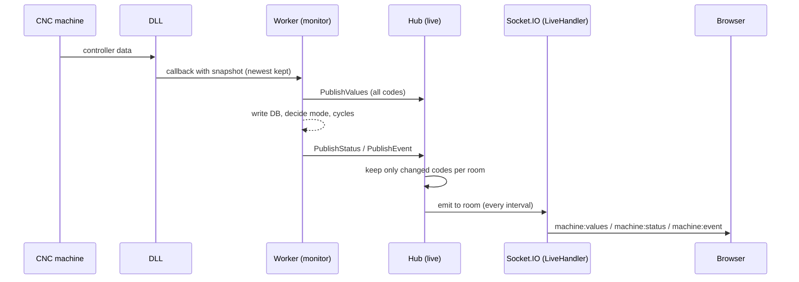

# Live data — how a machine value reaches the screen

This page explains in plain words how a value read from a CNC machine (spindle load, feed
override, program name, …) travels from the machine to the server and on to the browser over
Socket.IO, and how a screen picks which variables it gets.

- Why Socket.IO was chosen: [ADR 0009](adr/0009-socketio-live-data.md)
- The exact message formats and limits: [live-socket-events.md](live-socket-events.md)
- How the collector reads machines and decides modes / cycles: [cnc-data-collection-flow.md](cnc-data-collection-flow.md)

## The big picture

```
 CNC machine
     │  (vendor protocol, handled inside the DLL)
     ▼
 CncCommunication.dll ── calls back with a "snapshot" of the controller
     │
     ▼
 internal/cnc         Connection keeps only the newest reading, wakes the worker
     │
     ▼
 internal/monitor     one worker per machine: turns the snapshot into variable values
     │       │
     │       └──────► database (machine_variable_values, machine_telementry, mode log, cycles…)
     ▼
 internal/live        Hub: remembers the latest value of every variable of every machine,
     │                collects what changed per "room", sends it at most once per interval
     ▼
 internal/handler     LiveHandler: the Socket.IO server, knows which user owns each socket
     │                and which machines that user may see
     ▼  WebSocket  /api/v1/socket.io/
 Browser              services/liveSocket.js → hooks/useMachineLive.js → screen (Virtual Screen)
```

In short: **the machine talks to the DLL, the DLL talks to the worker, the worker tells the hub,
and the hub tells only the browsers that asked for that machine and those variables.**

## Step by step

### 1. Machine → DLL → server

1. When the server starts (`CNC_ENABLED=true`), the collector connects every active machine
   through `CncCommunication.dll` (`internal/cnc`, `Driver.Connect`).
2. The DLL calls the server back each time it has a new reading from the controller. A reading is
   a fixed "snapshot" structure: mode, program status, feed override, spindle load, axis
   positions, alarm number, program name, …
3. The callback runs on the DLL's own thread, so it must never wait. `Connection.publishReading`
   (`internal/cnc/cnc.go`) only stores the reading as "the newest one" and pokes the machine's
   worker. If several readings arrive while the worker is busy, only the newest is kept — the
   screen always gets the current state, never a backlog.

### 2. Worker → hub (before the database)

4. The machine's worker (`internal/monitor/worker.go`) wakes, takes the newest reading and maps
   each snapshot field to a variable code (e.g. snapshot field `SpindleLoad` → code `SpindleLoad`).
   Which fields become which codes is the **variable list** of the machine (see below).
5. **First** it hands all values to the hub: `publishValues` → `Hub.PublishValues`. This happens
   before any database write, so a slow database never delays the screen. Text values (program
   name, alarm message) go to the hub too, even though the database does not store them.
6. Then the worker does its normal work: stores changed numbers, decides the mode
   (`PublishStatus` sends a mode / online change), and records alarms, E-stops and cycles
   (`PublishEvent` sends `alarm_on`, `alarm_off`, `emergency_on`, `emergency_off`,
   `cycle_opened`, `cycle_closed`).

### 3. Hub → rooms

7. The hub (`internal/live/hub.go`) keeps, per machine, the latest value of every code and a
   counter `seq` that goes up on every change.
8. When a value is the same as before, nothing happens. When it changed, the hub marks it as
   "pending" in every room that watches that code.
9. The hub's own loop (`Hub.Run`) sends:
   - values: each room's pending changes at most once per the room's interval (default 1 s,
     never faster than `LIVE_MIN_INTERVAL_MS` = 200 ms) as `machine:values`, **only the codes that
     changed**;
   - status and events: right away, as `machine:status` and `machine:event`.

### 4. Socket.IO → browser

10. `LiveHandler` (`internal/handler/live_handler.go`) is the Socket.IO server. It emits each
    message to a room, and Socket.IO delivers it to every socket in that room.
11. In the browser, `services/liveSocket.js` receives the message, drops it if it is older than
    the snapshot it already has (`seq` check), merges the new values into the machine's state and
    tells the components that use it. `useMachineLive` re-renders only the screens showing that
    machine.



## Connecting the socket

- The browser opens **one** socket per tab at `/api/v1/socket.io/` (a "log in as" tab uses
  `/api/as/<key>/v1/socket.io/`), WebSocket only.
- No login message is sent: the server reads the normal session cookie of the handshake. No
  session → 401, the socket never opens.
- On connect the server loads the machines this user may read, with the same rule as the REST
  API (`MachineService.GetAll`). A user can never watch a machine they cannot open on the
  Machines page.

## How the variable list works

There are two lists: what the **server reads** from a machine, and what a **screen asks for**.

### What the server reads (the machine's variable list)

Every variable is a row in `cnc_variables` with a `code` (e.g. `SpindleLoad`, `feedRateOvr`,
`progName`). When a worker starts, it loads the list for its machine with
`MachineTelemetryRepository.FindVariableConfig`:

1. take every active variable in `cnc_variables`;
2. find where to read it for this machine's controller type in `cnc_variable_addresses`
   (for example: Fanuc → snapshot field `SpindleLoad`); a row for the exact controller version
   wins over a general one;
3. apply the machine's own overrides from `machine_variables` (a machine can switch a variable
   off, or use another address);
4. keep only addresses the server can read today — the DLL snapshot (`snapshot`). PLC / NC
   addresses wait for a DLL read function and are logged as `cnc: active variables not readable`.

The worker then tells the hub which codes this machine has (`Hub.SetMachineCodes`). If someone
edits the variables, `cnc_config_changed` makes the worker reload the list — no restart needed.

### What a screen asks for (subscribing)

A screen never gets "everything". It names exactly the codes it draws. The lists live in the
client's `constants/live.js`, e.g. the Virtual Screen:

```js
LIVE_CODES.VIRTUAL_SCREEN = ['SpindleLoad', 'SpindleRpm', 'speedOvr', 'feedRateOvr', 'actFeedRate',
  'FeedRev', 'axLoadX', 'axLoadY', 'axLoadZ', 'toolNumber', 'isEmergency', 'progName', 'Alarm', 'alarmMsg']
LIVE_INTERVAL_MS.VIRTUAL_SCREEN = 200
```

The screen uses the hook:

```js
const { values, status, connected, denied } =
  useMachineLive(machine.id, { codes: LIVE_CODES.VIRTUAL_SCREEN, intervalMs: 200, channels: ['status', 'event'] })
```

What happens then:

1. **Merge in the browser.** If several components on the page watch the same machine,
   `liveSocket.js` joins their needs: all their codes together, the smallest interval, all their
   channels. One machine = one subscription per tab.
2. **Send `subscribe`.**

   ```json
   { "machineIds": [225], "codes": ["SpindleLoad", "progName"], "channels": ["status", "event"], "intervalMs": 200 }
   ```

3. **Server checks it** (`dto.LiveSubscribeRequest.Validate`, then `LiveHandler.applySubscription`):
   - a machine the user may not read is put in `denied` and nothing is joined for it;
   - a code the machine does not read (not in its variable list) is put in `unknown`;
   - the rest is joined.
4. **Server joins rooms.** The socket joins:
   - one *values room* for "machine 225 + exactly these codes (sorted) + this interval",
     named like `m:225:v:<hash>@200`. Two tabs asking the same thing share the room, so the
     message is built once and sent to both;
   - `m:225:status` and / or `m:225:event` for the channels asked.
5. **Server answers with a snapshot.** The acknowledgement carries the current value of every
   code asked, plus the machine's mode / online state, so the screen is filled at once without
   waiting for the next change:

   ```json
   { "ok": true, "denied": [], "unknown": [],
     "snapshots": [{ "machineId": 225, "seq": 1840, "values": { "SpindleLoad": 41.5, "progName": "O1234" },
                     "online": true, "modeId": 3, "modeSince": "…", "programName": "O1234" }] }
   ```

   **Where "only what was asked" is enforced:** `Hub.JoinValues` keeps only the asked codes the
   machine reads (duplicates removed, the rest go to `unknown`), and `Hub.Snapshot(machineID, kept)`
   copies only those codes into `values` — a code asked but never read yet is left out. Machines
   not allowed get no snapshot at all. The status fields (`online`, `modeId`, `modeSince`,
   `programName`) are the one exception: they are in every snapshot once the collector reported
   the machine, whether or not the `status` channel was asked. Tests:
   `TestHubSnapshotHasOnlyRequestedCodes` (`internal/live/hub_test.go`) and
   `TestLiveData` › "subscribe gets only readable machines and known codes" (`tests/live_test.go`).

6. **From then on only changes arrive**, e.g. `{ machineId: 225, seq: 1841, values: { SpindleLoad: 43 } }`.
7. **Changing or stopping.** A new `subscribe` for the same machine replaces the old one (the
   socket leaves its old room). When the last component closes, the browser sends
   `unsubscribe { machineIds: [225] }`. A room nobody is in is dropped, so the hub stops
   building its messages.

## When something changes on the server

| Situation | What the socket sees |
|---|---|
| User's machine access changes (user edited / deleted, machine added / removed) | `access:changed { removed, added }`; removed machines' rooms are left at once (`user_access_changed` / `machines_changed` NOTIFY, and a full check every `LIVE_REVALIDATE_SEC`) |
| Logout, session expired, user deactivated | `session:expired`, then the socket is closed |
| Too many tabs (`LIVE_MAX_SOCKETS_PER_USER`) | the oldest socket of that user is closed |
| Socket drops / server restarts | the browser reconnects, subscribes again and gets a fresh snapshot (nothing is replayed) |
| `LIVE_ENABLED=false` | no socket at all; screens fall back to polling REST |

## Showing a new variable on a screen

1. If the server already reads it (it has a `snapshot` address for that controller type): add its
   code to the screen's list in `constants/live.js` and draw it. **No server change.**
2. If it is a new `cnc_variables` row with a snapshot address: add the rows; the workers pick it
   up through `cnc_config_changed`, then do step 1.
3. If it needs a PLC / NC address: the DLL needs a read function first.

## Files

| Part | File |
|---|---|
| DLL callback, newest reading | `internal/cnc/cnc.go`, `internal/cnc/dll_windows_386.go` |
| Variable list of a machine | `internal/repository/machine_telemetry_repository.go` (`FindVariableConfig`), `internal/monitor/worker.go` |
| Publish to the hub | `internal/monitor/worker.go` (`publishValues`, `PublishStatus`), `internal/monitor/machine_cycle.go` (cycle events) |
| Latest values, rooms, intervals | `internal/live/hub.go` |
| Socket.IO server, access, subscribe | `internal/handler/live_handler.go`, `internal/routes/live_routes.go`, `internal/dto/live_dto.go` |
| Wiring | `cmd/server/main.go` |
| Browser | `../7th-sense-client/src/services/liveSocket.js`, `hooks/useMachineLive.js`, `constants/live.js` |
